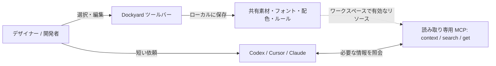

# Dockyard

[English](README.md) · [简体中文](README.zh-CN.md) · [日本語](README.ja.md) · [한국어](README.ko.md)

[](LICENSE)
[](docs/releasing.md)
[](https://modelcontextprotocol.io)
[](package.json)

**デザイナーと開発者のための、AI 向けローカルリソースハブとデスクトップツールバー。**
共有アセットをプロジェクト間で再利用し、AI への指示を Skill にまとめる前に手軽に試せます。


Dockyard は、AI を使った制作を支援する Windows 向けフローティングツールと MCP ブリッジです。
素材フォルダー、配色、フォントをプロジェクトごとにコピーしたり、毎回索引を作ったりする手間を減らします。また、正式な Skill やシステム指示にする前のルールを、軽量な環境で調整できます。

ローカルの共有リソースとルールを管理したら、AI には短く依頼するだけです。

> 「自分の暖色オレンジの配色を使ってください。」または「FX ルールに従ってください。」

AI は読み取り専用の MCP ツール `context`、`search`、`get` で必要な情報だけを取得します。長いパス、色値の一覧、ルール全文を最初のプロンプトに貼り付ける必要はありません。

## 表示言語

アプリは**簡体字中国語と英語**に対応しています。初回起動時はシステム言語に従い、中国語環境では簡体字中国語、それ以外では英語を使用します。
**More → Settings → Language / 语言** で System default、简体中文、English を選択できます。変更はすぐに反映され、この PC に保存されます。
言語設定はワークスペースから独立しています。切り替えても、保存済みのリソース名、ルール本文、ノートは書き換えられません。
README は英語・中国語・日本語・韓国語で提供しています。`docs/` 内の技術文書は現在、主に中国語です。

## 主な機能

- 🎨 **プロジェクト間で共有するアセットライブラリー。** 素材フォルダー、参考ファイル、配色、フォントをローカルにまとめ、ワークスペース単位で有効化・一時停止できます。選択したリソースだけを AI に公開します。
- 🧪 **AI ルールの実験スペース。** ツールバーから指示や一時的な制約を追加・編集できます。実際に使いながら改善し、定着した内容を正式な Skill にまとめられます。
- 🔌 **必要なときだけ MCP で照会。** 読み取り専用の `context`、`search`、`get` で名前や ID を指定して取得します。Codex 接続の自己診断を備え、コンテキストを小さく保ちます。
- 🪟 **すりガラス風のフローティングツールバー。** コンパクトなフレームレス UI に、連続カラーピッカー、画面スポイト、スクリーンショットの注釈、クリップボード連携、ノートキャンバスを搭載しています。

> [!NOTE]
> フォルダーは追加時または手動更新時にファイル索引を更新します。全文検索・意味検索には対応していません。ノートはデスクトップ専用で、MCP の検索対象には含まれません。

## 画面プレビュー

以下は英語 UI の画面です。

| ルールの管理と実験 | 配色とカラーピッカー | フォント設定とプレビュー |
| :---: | :---: | :---: |
|  |  |  |

ワークスペース構成とリソース形式の詳細は、[Web デザインリソース](docs/design-resources.md) と [データ形式・Core API](docs/data-format.md) を参照してください（中国語）。

## 設定プリセット

ワークスペース横の Configure から空のプリセットを作成するか、現在のプリセットを複製できます。素材、ルール、スイッチ、スライダー、色、選択肢、テキストを追加し、構成と値をプリセットごとに保存します。変更は自動保存され、失敗時は下書きが保持されます。Copy for AI は短い設定参照をコピーし、AI が MCP で必要な値を取得します。


## ワークフロー



## プロジェクト用 Skill：短い依頼で Dockyard を使う

このリポジトリには軽量な [dock Skill](.agents/skills/dock/SKILL.md) が含まれています。Skill は AI に照会と適用の手順を案内し、リソース本体と指示は Dockyard に保存します。配色やルールの編集は次の照会で反映され、Skill へのコピーは不要です。

### プロジェクトに導入する

AI クライアントを Dockyard MCP に接続してから、`.agents/skills/dock` フォルダーを利用先のプロジェクトへコピーします。

```text
プロジェクト/
└─ .agents/skills/dock/SKILL.md
```

これは Codex のプロジェクト用 Skill の配置場所です。このリポジトリには配置済みです。他のクライアントでは対応する Skill ディレクトリーを使用してください。Skill の配置だけでは MCP 接続や Dockyard のワークスペース切り替えは行われません。

### 使用例

```text
#Dock 現在のデフォルト配色を確認してください
#Dock FX ルールに従ってこのページを改善してください
自分の暖色オレンジの配色を使ってください
```

`#Dock` は Skill で定めた起動用マーカーです。個人の配色、フォント、素材、ルールへの自然な依頼でも AI が判断して適用する場合があります。Codex では `$dock` で明示的に呼び出せます。

正確な名前や ID が分かる場合は直接取得し、曖昧な場合は先に検索します。デフォルト設定は参照先を確認してから完全な内容を取得します。見つからない場合や候補が複数ある場合は、その状況を説明します。

### 会話例

ユーザーが `#Dock` を付けて Ocean blue の配色の確認と適用を依頼すると、AI は色値を取得し、ボタン・カード・テキストへの適用例を示します。

下図は、実際の MCP 照会で返された「海岸蓝」の 9 色から作成した会話の説明図です。英語版の図では配色名を「Ocean blue」と表記し、ラベルと会話を英語に翻訳しています。実際のチャット画面や実行中の Web ページではありません。正確な色値は MCP の返却データに従ってください。マーカーを使ったデフォルト配色の取得は確認済みですが、自然言語による起動は実際の利用で検証が必要です。


## 入手と実行

このリポジトリではインストールパッケージをまだ公開していません。以下の手順でソースから実行してください。今後の Windows x64 パッケージは [Releases](https://github.com/macydog-m/Dockyard/releases) に掲載します。現在のビルドは未署名で、クリーン環境での検証は未完了です。macOS・Linux のデスクトップ版には対応していません。

Portable ZIP は全体を展開し、最上位の **Dockyard.exe** を起動します。データは隣の **Data** フォルダーに保存されます。更新時はアプリを終了し、新版を別の場所に展開して旧 Data フォルダーをコピーしてください。旧版では新しい設定形式を編集できないため、更新前にバックアップしてください。[更新手順](docs/releasing.md)。

ソースからの実行には Node.js 24 と npm が必要です。

```powershell
npm ci
npm run desktop
```

初回起動時に `%LOCALAPPDATA%/Dockyard` に空のワークスペースを作成します。**Workspaces → Manage resources** でリソースを追加し、現在のワークスペースに含めてから **Settings → Connect agent** を選択して設定を確認します。クライアントに応じて MCP の再起動または新しいセッションの開始が必要です。**Check connection** は独立したローカル自己診断であり、モデルによる実際のツール呼び出しはホスト側で確認してください。

Cursor や Claude Desktop など、Stdio MCP に対応するクライアントでは、`npm run build` の実行後に次の設定を利用できます。

```json
{
  "mcpServers": {
    "dockyard": {
      "command": "node",
      "args": ["<absolute-path-to-Dockyard>/packages/mcp/dist/index.js"]
    }
  }
}
```

開発・テストには独立したデモデータを使用してください。

```powershell
npm run desktop:build
node scripts/dockyard.mjs demo --data-dir .local/my-demo
npx electron apps/desktop --data-dir .local/my-demo
```

デモの作成先は、まだ存在しないディレクトリーを指定します。サンプルに個人の素材は含まれません。ローカル用インストーラーの作成は [バージョンとパッケージ](docs/releasing.md) を参照してください（中国語）。インストーラーはランタイムを同梱し、利用者による Node.js の別途インストールは不要です。

## プライバシーとデータの範囲

設定と索引はローカルに保存します。MCP は現在のワークスペースで有効なリソースだけを照会し、素材の変更やファイル本文の読み取りは行いません。ただし、パス、リソース情報、ルール本文を返します。AI クライアントはそれらをモデルサービスに送信したり、自身の権限でファイルを読み取ったりする場合があります。そのクライアントに渡してよいリソースだけを有効にしてください。

スクリーンショットのキャッシュ、ノート、Codex 設定のバックアップには個人情報が含まれる可能性があります。アンインストールしてもリソースデータは保持されます。詳細は [プライバシーとデータの範囲](docs/privacy.md) を参照してください（中国語）。

## 開発と参加

```powershell
npm test
npm run desktop:build
npm run desktop:language-smoke
npm run privacy:check
```

言語のスモークテストは独立したデータと合成画面ピクセルを使用し、即時切り替え、再起動後の保持、ユーザーの内容、AI 用コピー、ネイティブダイアログの表示、画面キャプチャーの案内を確認します。

- [貢献ガイド](CONTRIBUTING.md) · [セキュリティ](SECURITY.md) · [変更履歴](CHANGELOG.md)
- [開発リファレンス](docs/development.md) · [デスクトップガイド](apps/desktop/README.md)
- [データ形式・Core API](docs/data-format.md) · [配色とフォント](docs/design-resources.md)
- [公開準備チェックリスト](docs/open-source-preparation.md) · [リポジトリの保守](docs/repository-maintenance.md)

詳細文書は現在、中国語で提供しています。このソースは公開候補の基準版です。機能とリリース状況は本 README とバージョン記録に従ってください。

## ライセンス

Dockyard のオリジナルコードは [MIT](LICENSE) ライセンスです。第三者のコードと素材には各ライセンスとクレジットが適用されます。[第三者に関する表記](THIRD_PARTY_NOTICES.md) を参照してください。ノート用アイコンの出典、ライセンス、過去の取り扱いは [SVG 監査記録](docs/notebook-svg-license-audit.md) に記載しています（中国語）。

## ワークスペース固定と構成コンポーネント

MCP の `--workspace-id <id>` で検索範囲を固定できます。省略するとグローバル選択に従います。構成コンポーネントは素材やルールの参照、スイッチ、選択肢、数値を一つのパネルにまとめ、値と任意のプリセットをワークスペースごとに保存します。MCP は有効な構成項目に従ってリソースを絞り込みます。セッションの自動認識は未対応です。[使い方（中国語）](docs/workspace-configuration.md) · [Codex 検証と制限（中国語）](docs/codex-binding-validation.md)。
