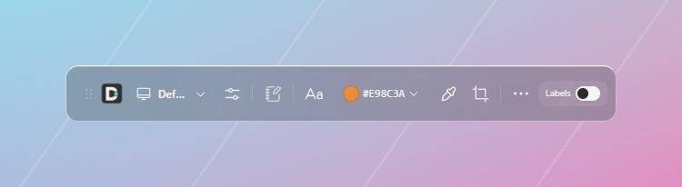
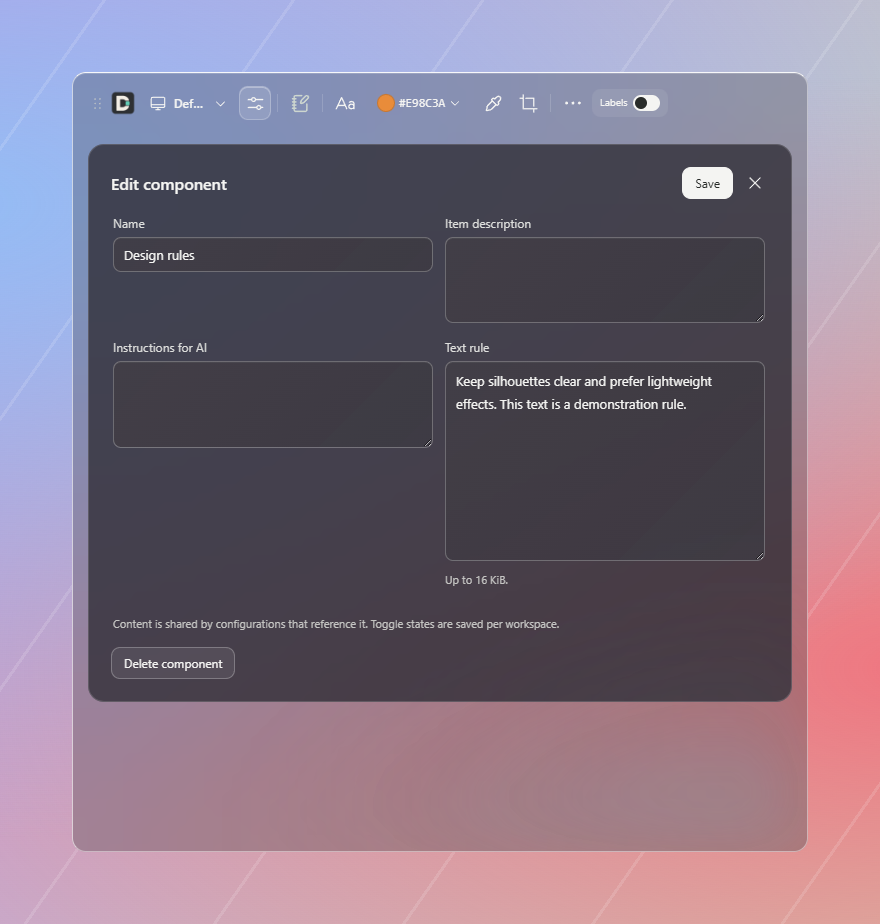
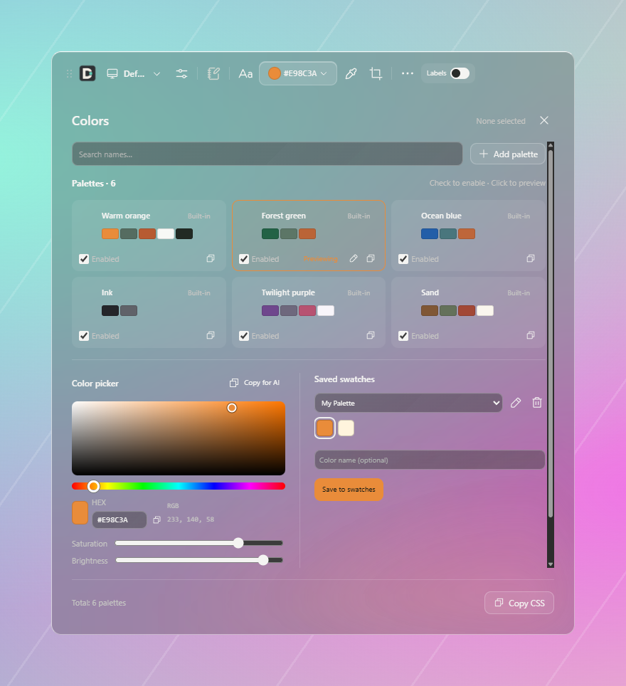
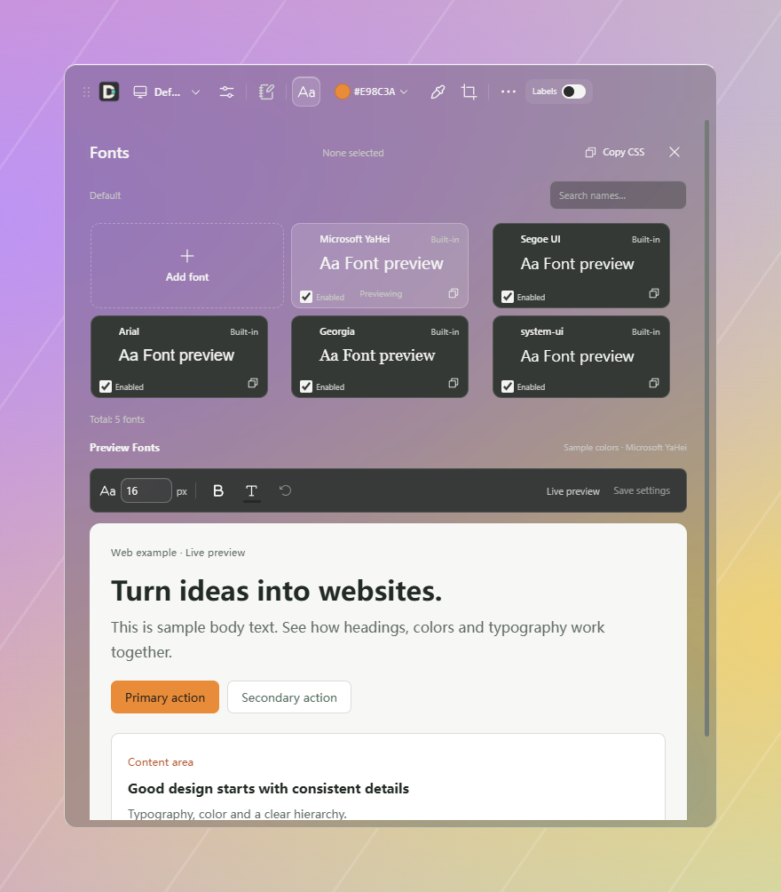
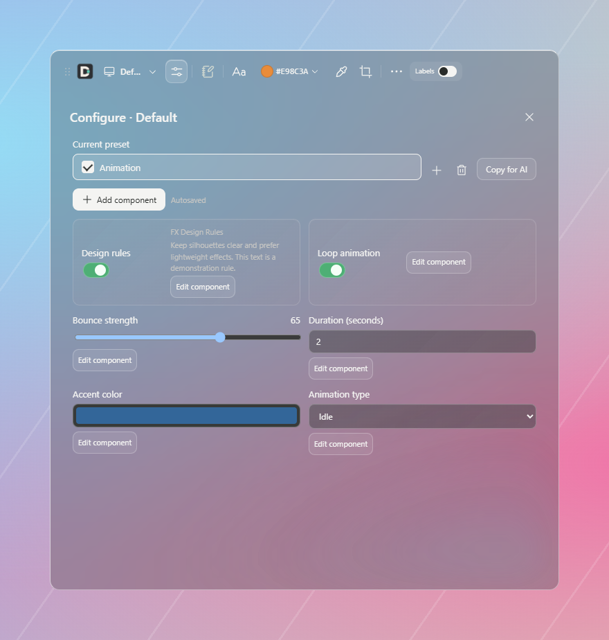
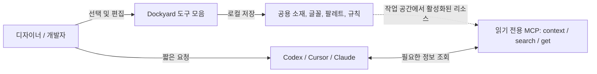
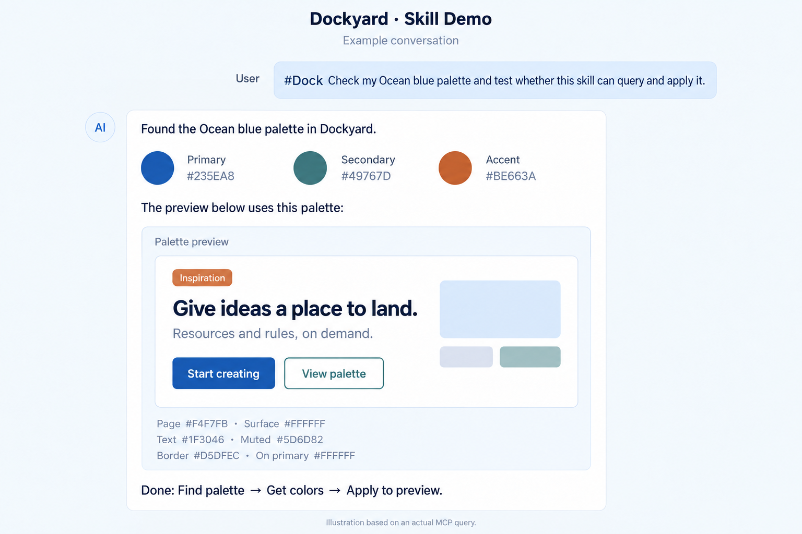

# Dockyard

[English](README.md) · [简体中文](README.zh-CN.md) · [日本語](README.ja.md) · [한국어](README.ko.md)

[](LICENSE)
[](docs/releasing.md)
[](https://modelcontextprotocol.io)
[](package.json)

**디자이너와 개발자를 위한 AI 로컬 리소스 허브이자 데스크톱 도구 모음입니다.**
공용 에셋을 여러 프로젝트에서 재사용하고, AI 규칙을 Skill로 정리하기 전에 가볍게 시험해 보세요.



Dockyard는 AI와 함께 작업하는 Windows 사용자를 위한 플로팅 데스크톱 도구이자 MCP 브리지입니다.
소재 폴더, 팔레트, 글꼴이 프로젝트 저장소 밖에 흩어져 있으면 프로젝트마다 복사하거나 색인을 다시 만들어야 합니다. AI 규칙 역시 정식 Skill이나 시스템 지침으로 만들기 전에 쉽게 수정하고 확인할 공간이 필요합니다.

Dockyard에서 로컬 공용 리소스와 규칙을 관리한 뒤, AI에 짧게 요청하면 됩니다.

> “내 따뜻한 주황 팔레트를 사용해 주세요.” 또는 “FX 규칙에 따라 처리해 주세요.”

AI는 읽기 전용 MCP 도구인 `context`, `search`, `get`으로 필요한 정보만 가져옵니다. 긴 경로, 색상 값 목록, 규칙 전문을 첫 프롬프트에 붙여 넣을 필요가 없습니다.

## 인터페이스 언어

앱은 **중국어 간체와 영어**를 지원합니다. 처음 실행하면 시스템 언어를 따릅니다. 중국어 시스템에서는 중국어 간체를, 그 밖의 시스템에서는 영어를 사용합니다.
**More → Settings → Language / 语言**에서 System default, 简体中文 또는 English를 선택할 수 있습니다. 변경 사항은 즉시 적용되며 이 컴퓨터에 저장됩니다.
언어 설정은 작업 공간과 별개입니다. 언어를 바꿔도 저장된 리소스 이름, 규칙 본문, 메모는 변경되지 않습니다.
README는 영어·중국어·일본어·한국어로 제공됩니다. `docs/`의 기술 문서는 현재 주로 중국어입니다.

## 주요 기능

- 🎨 **프로젝트 간 공용 에셋 라이브러리.** 소재 폴더, 참고 파일, 팔레트, 글꼴을 로컬에 모으고 작업 공간별로 활성화하거나 일시 중지합니다. 선택한 리소스만 AI에 제공합니다.
- 🧪 **AI 규칙 실험 공간.** 도구 모음에서 지침이나 임시 제약을 바로 추가하고 수정합니다. 사용하면서 개선한 다음 검증된 내용을 정식 Skill로 정리할 수 있습니다.
- 🔌 **필요할 때 조회하는 MCP.** 읽기 전용 `context`, `search`, `get`으로 이름이나 ID를 지정해 조회합니다. 내장된 Codex 연결 자체 진단으로 설정을 확인하고 컨텍스트 사용량을 줄입니다.
- 🪟 **반투명 플로팅 도구 모음.** 작고 테두리 없는 도구 모음에 연속 색상 선택기, 화면 스포이트, 스크린샷 주석, 클립보드 연동, 메모 캔버스를 제공합니다.

> [!NOTE]
> 폴더는 추가하거나 수동 새로 고침할 때 파일 색인을 갱신합니다. 본문 검색과 의미 기반 검색은 지원하지 않습니다. 메모는 데스크톱 전용이며 MCP 조회에 포함되지 않습니다.

## 화면 미리 보기

다음은 영어 UI 화면입니다.

| 규칙 관리와 실험 | 팔레트와 색상 선택기 | 글꼴 설정과 미리 보기 |
| :---: | :---: | :---: |
|  |  |  |

작업 공간 구성과 리소스 형식은 [웹 디자인 리소스](docs/design-resources.md)와 [데이터 형식 및 Core API](docs/data-format.md)를 참고하세요(중국어).

## 설정 프리셋

작업 공간 옆 Configure에서 빈 프리셋을 만들거나 현재 프리셋을 복사할 수 있습니다. 리소스, 규칙, 스위치, 슬라이더, 색상, 선택 항목과 텍스트를 추가하면 각 프리셋에 구성과 값이 독립적으로 저장됩니다. 변경은 자동 저장되며 실패하면 초안을 유지합니다. Copy for AI는 짧은 설정 참조를 복사하고 AI가 MCP로 적용된 값을 조회합니다.



## 작업 흐름



## 프로젝트 Skill: 짧은 요청으로 Dockyard 사용하기

저장소에는 가벼운 [dock Skill](.agents/skills/dock/SKILL.md)이 포함되어 있습니다. Skill은 AI가 리소스를 조회하고 적용하도록 안내하며, 실제 리소스와 지침은 Dockyard에 보관됩니다. 팔레트나 규칙을 수정하면 다음 조회에서 최신 내용을 가져오므로 Skill에 다시 복사할 필요가 없습니다.

### 프로젝트에 설치

먼저 AI 클라이언트를 Dockyard MCP에 연결한 뒤 `.agents/skills/dock` 폴더를 사용할 프로젝트로 복사하세요.

```text
프로젝트/
└─ .agents/skills/dock/SKILL.md
```

이 경로는 Codex의 프로젝트 단위 Skill 위치이며, 현재 저장소에는 이미 포함되어 있습니다. 다른 클라이언트는 해당 클라이언트의 Skill 디렉터리를 사용하세요. Skill을 설치하는 것만으로 MCP에 연결되거나 Dockyard의 현재 작업 공간이 바뀌지는 않습니다.

### 사용 예시

```text
#Dock 현재 기본 팔레트를 확인해 주세요
#Dock FX 규칙에 따라 이 페이지를 개선해 주세요
내 따뜻한 주황 팔레트를 사용해 주세요
```

`#Dock`은 Skill에 정의된 호출 표식입니다. 개인 팔레트, 글꼴, 소재, 규칙에 관한 자연스러운 요청도 AI의 판단에 따라 연결될 수 있습니다. Codex에서는 `$dock`으로 명시적으로 호출할 수 있습니다.

정확한 이름이나 ID를 알고 있으면 바로 가져오고, 요청이 모호하면 먼저 검색합니다. 기본 설정을 조회할 때는 기본 참조를 확인한 다음 전체 구성을 가져옵니다. 리소스가 없거나 후보가 여러 개라면 그 상황을 설명합니다.

### 대화 예시

사용자가 `#Dock`을 붙여 Ocean blue 팔레트를 조회하고 적용해 달라고 요청하면 AI가 색상 값을 가져와 버튼, 카드, 텍스트에 적용한 예시를 보여 줍니다.

아래 그림은 실제 MCP 조회로 반환된 “海岸蓝”의 9개 색상으로 만든 대화 설명 이미지입니다. 영어 이미지에서는 팔레트 이름을 “Ocean blue”로 표기하고 라벨과 대화를 영어로 번역했습니다. 실제 채팅 화면이나 실행 중인 웹 페이지는 아닙니다. 정확한 색상 값은 MCP 반환 데이터를 기준으로 하세요. 표식을 이용한 기본 팔레트 조회는 확인했으며, 자연어 호출은 실제 사용 중 추가 검증이 필요합니다.



## 설치 준비와 실행

이 저장소에는 아직 설치 패키지가 게시되지 않았습니다. 아래 안내에 따라 소스에서 실행하세요. 향후 Windows x64 패키지는 [Releases](https://github.com/macydog-m/Dockyard/releases)에 게시됩니다. 현재 빌드는 서명되지 않았으며 깨끗한 Windows 환경에서의 전체 검증은 완료되지 않았습니다. macOS와 Linux 데스크톱은 지원하지 않습니다.

Portable ZIP 전체를 압축 해제하고 최상위 **Dockyard.exe**를 실행하세요. 데이터는 옆의 **Data** 폴더에 저장됩니다. 업데이트할 때 앱을 종료하고 새 버전을 별도로 압축 해제한 다음 기존 Data 폴더 전체를 복사하세요. 이전 버전은 새 설정 형식을 편집할 수 없으므로 먼저 백업하세요. [업데이트 안내](docs/releasing.md).

소스에서 실행하려면 Node.js 24와 npm이 필요합니다.

```powershell
npm ci
npm run desktop
```

처음 실행하면 `%LOCALAPPDATA%/Dockyard`에 빈 작업 공간이 만들어집니다. **Workspaces → Manage resources**에서 리소스를 추가하고 현재 작업 공간에 포함한 뒤 **Settings → Connect agent**를 눌러 설정을 확인하세요. 클라이언트 요구에 따라 MCP를 다시 시작하거나 새 세션을 열어야 합니다. **Check connection**은 독립적인 로컬 자체 진단이며, 모델의 실제 도구 호출은 호스트에서 확인해야 합니다.

Cursor나 Claude Desktop처럼 Stdio MCP를 지원하는 클라이언트에서는 `npm run build` 실행 후 다음 설정을 사용할 수 있습니다.

```json
{
  "mcpServers": {
    "dockyard": {
      "command": "node",
      "args": ["<absolute-path-to-Dockyard>/packages/mcp/dist/index.js"]
    }
  }
}
```

개발과 테스트에는 격리된 데모 데이터를 사용하세요.

```powershell
npm run desktop:build
node scripts/dockyard.mjs demo --data-dir .local/my-demo
npx electron apps/desktop --data-dir .local/my-demo
```

데모 대상 디렉터리는 아직 존재하지 않아야 합니다. 예시 리소스에는 실제 개인 소재가 포함되지 않습니다. 로컬 설치 프로그램을 만들려면 [버전 및 패키징](docs/releasing.md)을 참고하세요(중국어). 설치 프로그램에는 런타임이 포함되어 사용자가 Node.js를 따로 설치할 필요가 없습니다.

## 개인정보와 데이터 범위

설정과 색인은 로컬에 저장됩니다. MCP는 현재 작업 공간에서 활성화된 리소스만 조회하며 소재를 변경하거나 파일 본문을 읽지 않습니다. 다만 파일 경로, 리소스 정보, 규칙 본문은 반환합니다. AI 클라이언트는 이 결과를 모델 서비스로 보내거나 자체 권한으로 파일을 읽을 수 있습니다. 해당 클라이언트에 제공해도 되는 리소스만 활성화하세요.

스크린샷 캐시, 메모, Codex 설정 백업에는 개인정보가 포함될 수 있습니다. 제거 시 리소스 데이터는 유지됩니다. 자세한 내용은 [개인정보 및 데이터 범위](docs/privacy.md)를 참고하세요(중국어).

## 개발과 참여

```powershell
npm test
npm run desktop:build
npm run desktop:language-smoke
npm run privacy:check
```

언어 스모크 테스트는 격리된 데이터와 합성 화면 픽셀로 즉시 전환, 재시작 후 설정 유지, 사용자 내용 보존, AI용 복사 문구, 네이티브 대화 상자 표시, 화면 캡처 안내를 확인합니다.

- [기여 가이드](CONTRIBUTING.md) · [보안](SECURITY.md) · [변경 기록](CHANGELOG.md)
- [개발 참고 문서](docs/development.md) · [데스크톱 가이드](apps/desktop/README.md)
- [데이터 형식 및 Core API](docs/data-format.md) · [색상과 글꼴](docs/design-resources.md)
- [오픈 소스 준비 목록](docs/open-source-preparation.md) · [저장소 유지 관리](docs/repository-maintenance.md)

상세 문서는 현재 중국어로 제공됩니다. 이 소스는 오픈 소스 후보 기준 버전이며, 현재 기능과 배포 상태는 이 README와 버전 기록을 따릅니다.

## 라이선스

Dockyard 자체 코드는 [MIT](LICENSE) 라이선스입니다. 타사 코드와 에셋에는 각자의 라이선스와 출처 표기가 적용됩니다. [타사 고지](THIRD_PARTY_NOTICES.md)를 참고하세요. 메모 아이콘의 출처, 라이선스, 과거 처리 사항은 [SVG 검증 기록](docs/notebook-svg-license-audit.md)에 정리되어 있습니다(중국어).

## 워크스페이스 고정과 구성 컴포넌트

MCP의 `--workspace-id <id>`로 조회 범위를 고정할 수 있습니다. 생략하면 전역 선택을 따릅니다. 구성 컴포넌트는 에셋과 규칙 참조, 스위치, 선택 항목, 수치를 하나의 패널에서 관리하며 값과 선택적 프리셋을 워크스페이스별로 저장합니다. MCP는 활성 구성 항목에 따라 리소스를 필터링합니다. 세션 자동 인식은 아직 지원하지 않습니다. [사용법（중국어）](docs/workspace-configuration.md) · [Codex 검증 및 제한（중국어）](docs/codex-binding-validation.md).
