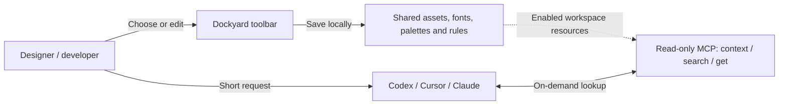

# Dockyard

[English](README.md) · [简体中文](README.zh-CN.md) · [日本語](README.ja.md) · [한국어](README.ko.md)

[](LICENSE)
[](docs/releasing.md)
[](https://modelcontextprotocol.io)
[](package.json)

**A local AI resource hub and desktop toolbar for designers and developers.**
Reuse shared assets across projects and try out AI rules before turning them into Skills.


Dockyard is a floating Windows desktop tool and MCP bridge for creative work with AI.
Asset folders, palettes and fonts often live outside project repositories; copying and indexing them for every project adds friction. Rules also need a lightweight place to evolve before they become formal Skills or system instructions.

Dockyard gives you a persistent local resource library and a place to experiment with rules. Choose a resource and give AI a short request:

> “Please use my warm orange palette.” or “Follow the FX rules.”

AI retrieves what it needs through the read-only MCP tools `context`, `search` and `get`. Paths, color values and complete rule text stay out of the initial prompt.

## Interface languages

The app supports **Simplified Chinese and English**. On first launch, Chinese system locales use Simplified Chinese; other system locales use English.
Open **More → Settings → Language / 语言** to select System default, 简体中文 or English. Changes apply immediately and are saved locally.
The preference is independent of workspaces. Switching languages preserves saved resource names, rule text and notes.
This README is available in English, Chinese, Japanese and Korean. Technical documents under `docs/` are currently mainly in Chinese.

## Features

- 🎨 **Shared assets across projects.** Collect reusable folders, reference files, palettes and fonts in a local library. Enable or pause resources by workspace so AI sees the resources you choose.
- 🧪 **A sandbox for AI rules.** Add and edit instructions or temporary constraints from the toolbar. Refine them in use, then turn proven instructions into a formal Skill.
- 🔌 **On-demand MCP queries.** Read-only `context`, `search` and `get` tools provide precise name or ID lookups. The built-in Codex connection check helps verify setup while keeping context small.
- 🪟 **A floating glass toolbar.** A compact, frameless toolbar includes a continuous color picker, screen eyedropper, screenshot annotations, clipboard integration and a notes canvas.

> [!NOTE]
> Folders use a file index refreshed on addition or manual refresh. Full-text and semantic search are not provided. Notes are desktop-only and are excluded from MCP queries.

## Preview

| Rules and experimentation | Palettes and color picker | Font settings and preview |
| :---: | :---: | :---: |
|  |  |  |

See [Web design resources](docs/design-resources.md) and [Data format and Core API](docs/data-format.md) for workspace composition and resource formats (Chinese).

## Configuration presets

Open **Configure** beside the workspace selector. Create a blank preset or copy the current one; add resource references, rules, switches, sliders, colors, choices and text. Each preset keeps its own structure and values. Changes save automatically; failed saves retain your draft. **Copy for AI** copies a short configuration reference, and MCP retrieves the applied values on demand.


## Workflow



## Project Skill: call Dockyard with a short request

The repository includes a lightweight [dock Skill](.agents/skills/dock/SKILL.md). The Skill guides AI to query and apply resources; resource data and instructions stay in Dockyard. Later queries retrieve your latest edits without copying rules into the Skill.

### Install in a project

Connect your AI client to Dockyard MCP, then copy `.agents/skills/dock` into the project that should use it:

```text
Your project/
└─ .agents/skills/dock/SKILL.md
```

This is Codex's project-level Skill location; this repository already includes it. Other clients should use their supported Skill directory. Installing the Skill does not connect MCP or change the active Dockyard workspace.

### Examples

```text
#Dock Show the current default palette
#Dock Improve this page using the FX rules
Use my warm orange palette
```

`#Dock` is a trigger convention in the Skill. Requests about your palettes, fonts, assets or rules can also match naturally; this depends on the AI's judgment. In Codex, `$dock` invokes the Skill explicitly.

AI can fetch an exact name or ID directly, search when the request is unclear, or read the default reference before fetching a complete scheme. Missing or ambiguous matches should be explained.

### Conversation example

A user asks AI to look up and apply the Ocean blue palette with `#Dock`. AI returns the colors and illustrates their use on buttons, cards and text.

The illustration below uses nine colors returned by an actual MCP query for the palette named “海岸蓝”, displayed here as “Ocean blue”. Labels and conversation text are translated for this English illustration. It is a conversation illustration, not a real chat screenshot or a running page. MCP data is authoritative. The marked default-palette lookup was verified; natural-language triggering still needs validation in actual use.


## Get and run

This repository has not published installation packages yet. Run from source using the instructions below. Future Windows x64 packages will be listed in [Releases](https://github.com/macydog-m/Dockyard/releases). Desktop builds are currently unsigned; clean-machine acceptance is incomplete. macOS and Linux desktop installation support is not claimed.

For the portable edition, extract the entire ZIP and run the top-level **Dockyard.exe**. Data stays in the adjacent **Data** folder. To upgrade, quit the app, extract the new version separately and copy the old Data folder. Back up your data before upgrading: older versions cannot edit the new configuration format. [Packaging and upgrade details](docs/releasing.md).

Running from source requires Node.js 24 and npm:

```powershell
npm ci
npm run desktop
```

The first launch creates an empty workspace under `%LOCALAPPDATA%/Dockyard`. Add resources in **Workspaces → Manage resources**, include them in the current workspace, then choose **Settings → Connect agent** and select your client. Codex offers automatic setup with a reviewed backup; Claude Code, Claude Desktop, Antigravity and Cursor offer configuration to copy and merge. Restart MCP or open a new client session as required. **Check connection** runs an independent local self-test; verify actual model tool calls in the host. See [Agent connections](docs/agent-connections.md) for configuration locations and verification limits.

Other Stdio MCP hosts, such as Cursor or Claude Desktop, can use this configuration after `npm run build`:

```json
{
  "mcpServers": {
    "dockyard": {
      "command": "node",
      "args": ["<absolute-path-to-Dockyard>/packages/mcp/dist/index.js"]
    }
  }
}
```

Use isolated demo data for development and testing:

```powershell
npm run desktop:build
node scripts/dockyard.mjs demo --data-dir .local/my-demo
npx electron apps/desktop --data-dir .local/my-demo
```

The demo destination must not already exist. Sample resources contain no personal assets. For local installers, see [Versioning and packaging](docs/releasing.md) (Chinese). Installers bundle the runtime; users do not need to install Node.js separately.

## Privacy and boundaries

Configuration and indexes are stored locally. MCP queries only enabled resources in the active workspace. It does not modify assets or read file contents, but returns paths, resource information or rule text. AI clients may send these results to a model service and read files under their own permissions. Enable only resources appropriate for that client.

Screenshot caches, notes and Codex configuration backups may contain private information. Uninstallation preserves resource data. See [Privacy and data boundaries](docs/privacy.md) (Chinese).

## Development and contributing

```powershell
npm test
npm run desktop:build
npm run desktop:language-smoke
npm run privacy:check
```

The language smoke test uses isolated data and synthetic screen pixels. It checks live switching, restart persistence, user content, AI clipboard text, native dialog labels and screenshot overlays.

- [Contributing](CONTRIBUTING.md) · [Security](SECURITY.md) · [Changelog](CHANGELOG.md)
- [Development reference](docs/development.md) · [Desktop guide](apps/desktop/README.md)
- [Data format and Core API](docs/data-format.md) · [Colors and fonts](docs/design-resources.md)
- [Open-source checklist](docs/open-source-preparation.md) · [Repository maintenance](docs/repository-maintenance.md)

These detailed guides are currently in Chinese. No installation packages have been published in this repository yet; this README and version records describe the current feature and release status.

## License

Original Dockyard code is licensed under [MIT](LICENSE). Third-party code and assets retain their own licenses and attribution; see [Third-party notices](THIRD_PARTY_NOTICES.md). Notebook icon sources, licenses and historical handling are documented in the [SVG audit](docs/notebook-svg-license-audit.md) (Chinese).

## Workspace bindings and configuration components

Fix an MCP server to a workspace with `--workspace-id <id>`, or leave it unbound to follow the global selection. Configuration components organize resource references, rules, switches, choices and parameters in one panel, with independent values and optional presets per workspace. MCP filters resources using the applied configuration, including resources listed directly in the workspace. Session auto-detection is not enabled. [Usage and data format](docs/workspace-configuration.md) · [Codex validation and limits](docs/codex-binding-validation.md).
