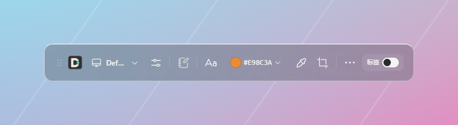
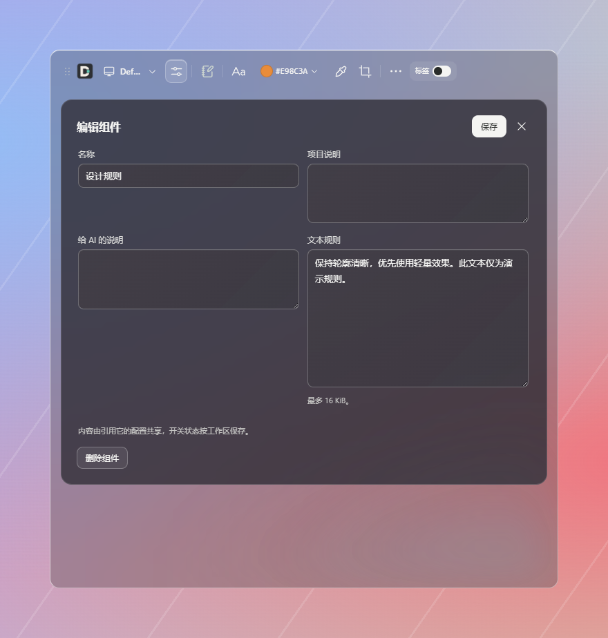
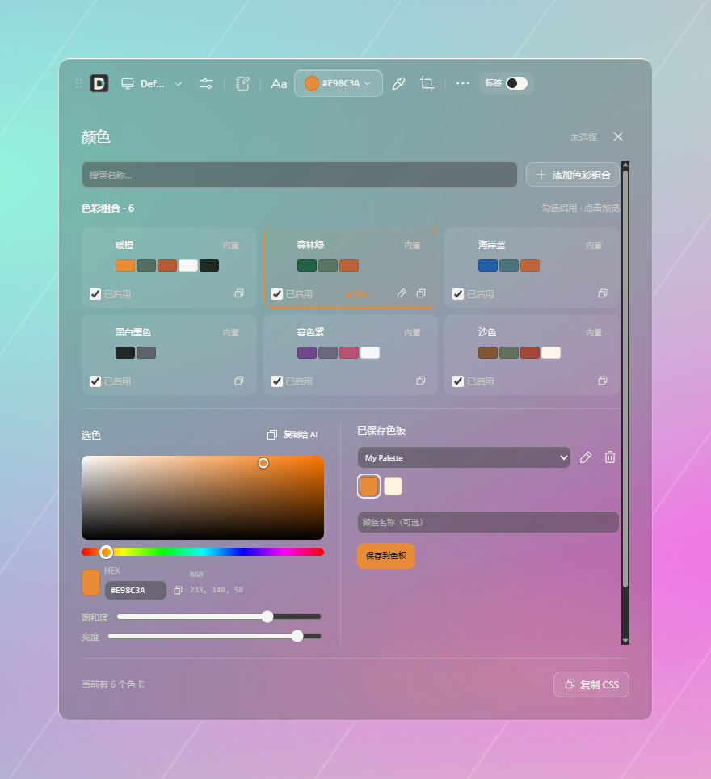
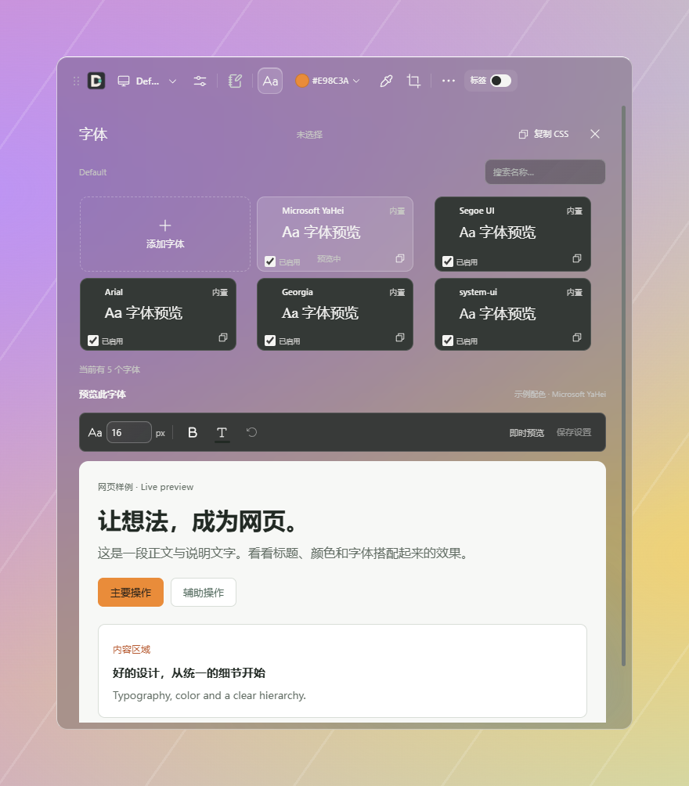
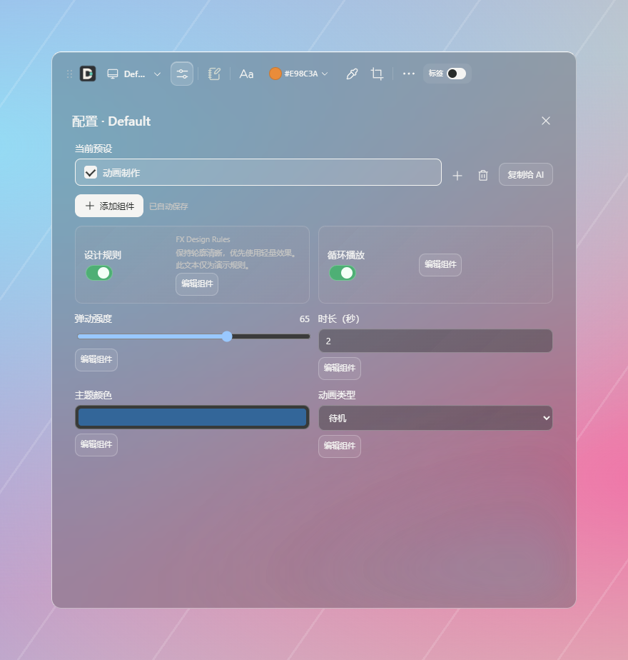
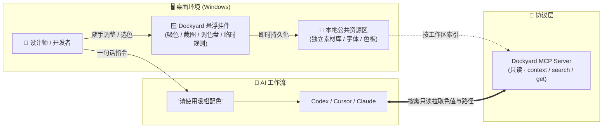
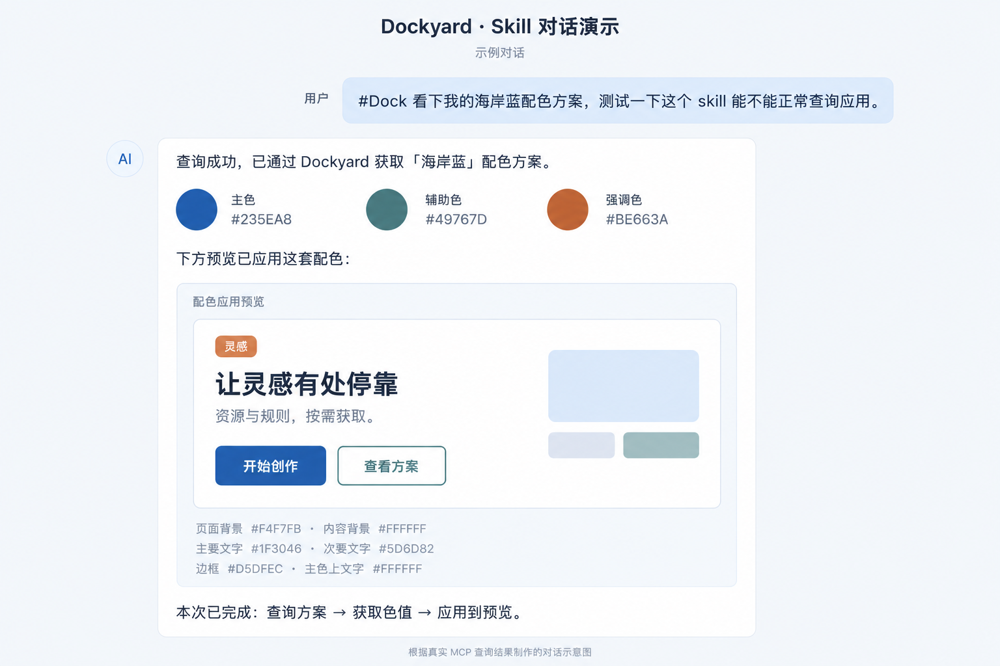

# Dockyard

[English](README.md) · [简体中文](README.zh-CN.md) · [日本語](README.ja.md) · [한국어](README.ko.md)

[](LICENSE)
[](docs/releasing.md)
[](https://modelcontextprotocol.io)
[](package.json)

**面向设计师与开发者的 AI 本地资源中枢与桌面挂件。**<br />
让公共资产跨项目按需调用，让 AI 规则在沉淀为 Skill 前敏捷试错。

---



Dockyard 是专为 AI 时代的设计师与创意开发者打造的 Windows 桌面悬浮工具与 MCP 桥梁。

在日常协作中，我们经常遇到两难：
- **设计资产大且分散**：高清素材、色板和字体库通常独立于项目代码，每次开新工程要么重复拷贝进仓库，要么重新建索引；
- **AI 规则调整成本高**：直接写进 Agent Skill 或 System Prompt 过于沉重，缺乏一个能随手微调、即时验证的轻量沙盒。

Dockyard 为此而生——它在桌面上为你提供一个常驻的**公共资源区**与**敏捷规则试验田**。选好资源后，给 AI 的输入只是一句简短意图：
> **“请使用暖橙配色方案。”** 或 **“参考 FX 规则处理。”**

AI 再通过只读 MCP 接口（`context` / `search` / `get`）按需精准拉取，不再需要把冗长的路径、色值清单或规则全文倾倒进聊天框。

---

## 界面语言

软件支持**简体中文与 English**。首次启动跟随系统语言：中文系统使用简体中文，其他系统使用英文。
在“更多 → 设置 → 语言 / Language”中可选择跟随系统、简体中文或 English，立即生效并保存到本机。
语言偏好独立于工作区；切换语言不会翻译或改写已保存的资源名称、规则正文与笔记。
README 提供中英日韩四种语言；`docs/` 技术文档目前以中文为主。

## 核心特性

- 🎨 **跨项目公共资产区 · 解耦独立**<br />
  将通用素材文件夹、规范文件、色板和字体归集在本地公共区，脱离单工程代码仓库，无需重复拷贝与索引；通过工作区一键启用或暂停，按需暴露给 AI。
- 🧪 **Skill 敏捷试验田 · 随手试错**<br />
  在桌面挂件中随时添加、修改设计指令与临时约束，无需繁琐重启会话或配置复杂 Skill 文件。摸清最佳实践后，再优雅地固化沉淀为正式 Skill。
- 🔌 **MCP 原生按需查询 · 上下文减负**<br />
  提供只读的 `context`、`search`、`get` MCP 工具，内置 Codex 连接自检。AI 随用随查，按名称或 ID 精确获取，杜绝 Context 倾倒并大幅节省 Token。
- 🪟 **原生毛玻璃悬浮挂件 · 丝滑协同**<br />
  约 48px 工具条高度的无边框原生毛玻璃小组件，集成连续色盘、屏幕吸色、截图标注（自动同步系统剪贴板与 AI 可查缓存）与灵感记事画布，不打扰创作主流程。

> [!NOTE]
> 文件夹通过索引搜索，在添加或手动刷新时更新（暂不提供正文搜索或语义检索）；记事本仅用于桌面端，不加入 MCP 查询。

---

## 界面预览

| 规则管理与试验田 | 配色方案与连续色盘 | 字体排版与来源预览 |
| :---: | :---: | :---: |
|  |  |  |

> 多工作区组合、公共资产管理与数据规范详见 [网页设计资源](docs/design-resources.md) 与 [数据格式与 Core API](docs/data-format.md)。

---

## 配置预设

点击工作区旁的「配置」，新建空白预设或复制当前预设，添加素材引用、规则、开关、滑块、颜色、选项和文本。每个预设独立保存组件结构与参数，修改自动保存，保存失败时保留草稿。「复制给 AI」仅复制简短配置引用，AI 再通过 MCP 按需读取当前生效内容。



## 工作流与协同架构



---

## 项目级 Skill：一句话调用 Dockyard

仓库提供轻量的 [dock Skill](.agents/skills/dock/SKILL.md)：**Skill 只负责引导 AI 查询并应用，具体指令与资源仍保存在 Dockyard。** 修改配色或规则后，后续查询直接获取更新后的内容，无需把规则复制进 Skill。

### 按项目安装

先让 AI 客户端连接 Dockyard MCP，再将本仓库的 `.agents/skills/dock` 文件夹复制到需要使用它的项目中：

```text
你的项目/
└─ .agents/skills/dock/SKILL.md
```

这是 Codex 的项目级技能位置；当前仓库已包含该技能。其他客户端请使用其支持的技能目录。安装 Skill 不会自动连接 MCP，也不会切换 Dockyard 当前工作区。

### 使用示例

```text
#Dock 查看当前默认配色方案
#Dock 按 FX 规则优化这个页面
使用我的暖橙配色方案
```

`#Dock` 是技能约定的触发标记，也支持根据个人配色、字体、素材或规则需求自然匹配。自然匹配由 AI 判断；在 Codex 中还可以用 `$dock` 显式调用。

AI 已知准确名称或 ID 时直接获取；需求模糊时先搜索；查询默认方案时先读取当前默认引用，再获取完整方案。找不到或有多个匹配时会说明情况。

### 对话示例：查询并应用配色

用户发送 `#Dock 看下我的海岸蓝配色方案，测试一下这个 skill 能不能正常查询应用。`，AI 查询后返回色值，并在回复中展示按钮、卡片与文字的配色应用预览。

下图依据实际 MCP 查询返回的「海岸蓝」九项色值生成，属于对话示意图，并非真实聊天截图或已运行页面；精确色值以 MCP 返回数据为准。实际查询已验证带 `#Dock` 标记的默认方案获取流程，自然语言触发仍需在使用中验证。



---

## 获取与运行

本仓库暂未发布安装包，请按下方步骤从源码运行。未来的 Windows x64 安装包会发布到 [Releases](https://github.com/macydog-m/Dockyard/releases)。当前桌面构建未签名，尚未完成全部干净机器验收，不宣称支持 macOS 或 Linux 桌面安装。

绿色版请完整解压，运行根目录的 **Dockyard.exe**，数据保存在旁边的 **Data** 文件夹。升级时先退出程序，将新版解压到新目录，再复制旧版的整个 Data 文件夹。升级前请备份数据：旧版本不能编辑新的配置格式。[安装与升级说明](docs/releasing.md)。

从源码运行需要 Node.js 24 和 npm：

```powershell
npm ci
npm run desktop
```

首次打开会在 `%LOCALAPPDATA%/Dockyard` 创建空工作区。在“预设工作区 → 管理资源”中添加
资源并选入当前工作区，然后点击“设置 → 连接 Agent”，检查并确认连接配置。按客户端要求
重启 MCP 或新建会话后即可查询。“检查连接”只表示独立自检结果，不代表真实模型已调用。

在 Cursor 或 Claude Desktop 等其他 MCP 宿主中，可通过配置 Stdio 服务连接（需先运行 `npm run build`）：

```json
{
  "mcpServers": {
    "dockyard": {
      "command": "node",
      "args": ["<Dockyard仓库绝对路径>/packages/mcp/dist/index.js"]
    }
  }
}
```

开发与测试优先使用隔离的演示数据：

```powershell
npm run desktop:build
node scripts/dockyard.mjs demo --data-dir .local/my-demo
npx electron apps/desktop --data-dir .local/my-demo
```

演示目录必须不存在；示例资源不包含真实个人素材。需要本地安装包时，参见
[版本与打包](docs/releasing.md)。安装包包含运行时，使用者不需要另装 Node.js。

## 隐私与边界

配置和索引保存在本机。MCP 只查询当前工作区启用的资源，不改写素材，也不读取文件正文；
但它会返回文件路径、资源信息或规则正文，AI 客户端可能将这些结果发送给模型服务，
并在自身权限下进一步读取文件。请只启用适合交给该客户端的资源。

截图缓存、笔记和 Codex 配置备份可能包含私人信息。卸载保留资源数据。
详细说明见 [隐私与数据边界](docs/privacy.md)。

## 开发与参与

```powershell
npm test
npm run desktop:build
npm run desktop:language-smoke
npm run privacy:check
```

- [贡献指南](CONTRIBUTING.md) · [安全问题](SECURITY.md) · [变更记录](CHANGELOG.md)
- [开发与操作参考](docs/development.md) · [桌面说明](apps/desktop/README.md)
- [数据格式与 Core API](docs/data-format.md) · [配色与字体](docs/design-resources.md)
- [开源准备清单](docs/open-source-preparation.md) · [两个仓库的维护守则](docs/repository-maintenance.md)

当前源码为开源候选基线，功能和发行状态以本文及版本记录为准。

## 许可证

Dockyard 原创代码使用 [MIT](LICENSE) 许可证。第三方代码与资源保留各自的许可证
和署名，见 [第三方声明](THIRD_PARTY_NOTICES.md)。记事本图标的官方来源、许可与
历史处理要求见 [SVG 核验记录](docs/notebook-svg-license-audit.md)。

## Workspace 绑定与统一配置组件

MCP 支持 `--workspace-id <id>` 固定查询范围，省略时跟随全局工作区。「配置」组件统一组织素材、规则等资源引用，以及开关、选择和滑块等参数。各工作区独立保存状态，预设按需使用；MCP 按配置中的启用项过滤资源，旧的组件列表不能绕过开关。任务自动识别尚未启用。[使用与数据格式](docs/workspace-configuration.md) · [Codex 验证与限制](docs/codex-binding-validation.md)。
